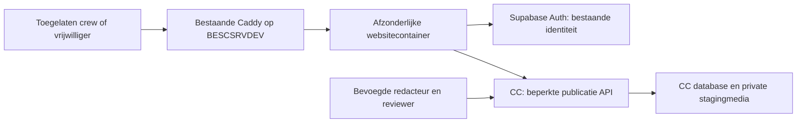

# Architectuur en beveiliging

## Verantwoordelijkheden

De website gebruikt Supabase uitsluitend voor Auth. Bedrijfsgegevens en media gaan via de beperkte CC-API; geen databaseverbinding, service_role of botcredential op de website. De website krijgt een afzonderlijke servercredential met alleen staging-leesrecht. Het CC blijft eigenaar van bron, rechten, revisies en audit. Geen kopie-CRM, gedeelde code-repo of gezamenlijke appimage.

## Toegang vóór inhoud

Alle inhoudsroutes, serverrendering, React Server Components, JSON, metadata, OG, sitemap en redactionele media zijn afgeschermd. Alleen de login, noodzakelijke Auth-callback, niet-vertrouwelijke merkbestanden en een minimale healthresponse zijn vrijgesteld. Sitemap wordt op staging niet gepubliceerd; robots weigert crawling. X-Robots-Tag noindex is aanvullend en geen toegangscontrole. Geen inhoud of titels uitlekken via loginredirect, foutmelding, zoekmachinepreview of prefetch.

Gebruik bestaande Supabase-accounts met apart hostgebonden websitecookies. Geen cookie-Domain op het hoofddomein en geen kopie van CC-sessiecookies. Geen self-signup, nieuwe OAuth-provider of brede scopes. Sessie serverzijdig verifiëren; niet vertrouwen op een ongetekend cookie, user_metadata, alleen een e-mailadres of client-side check. Callback alleen naar de expliciete staginghost en veilige relatieve vervolgpaden.

Een afgeschermd testerregister bevat account-ID, bewijs van actuele crew-/vrijwilligersstatus, toelater, begin/einde en audit. Bestaande profielen en lidmaatschappen hergebruiken; geen extra formele identiteit of bestuursmandaten toekennen. De actuele accountstatus, organisatiebinding en toelating worden bij elke inhoudsaanvraag opnieuw gecontroleerd. Tijdelijke testtoegang eindigt expliciet. Geen toegang louter op basis van aanwezigheid in Discord. De concrete roster wordt niet in Git gezet.

Website → CC vereist zowel een eigen sitecredential als de geverifieerde viewer-JWT. CC leidt organisatie, site en stagingkanaal af uit serverconfiguratie, nooit uit vrij invoerbare queryvelden. De API controleert zelf de viewer; websitechecks alleen zijn onvoldoende. Een auth-gerelateerde RPC mag uitsluitend het toegestane publicatieprojectieresultaat teruggeven en controleert dezelfde actuele rechten. Anon en gewone authenticated-accounts zonder toelating krijgen geen directe publicatietabellen of Storage-toegang.

## Inhoudsveiligheid

Strikte veldselectie in SQL én responsevalidatie in CC én runtimevalidatie in de website. Geen object-spread van bronrecords. Geen private bron-ID's, contactgegevens, rechtenbewijzen, contracten, budgetten of reviewnotities. HTML opnieuw saneren met een onderhouden parser/allowlist; schemaformat sanitized_html alleen is geen bewijs van veilige HTML. Geen scripts, inline events, embeds, formulieren of trackingpixels. Restrictieve CSP, nosniff, frame-ancestors, veilig referrerbeleid en veilige externe links; niet loggen met tokens of complete private payloads.

Alle redactionele media lopen via eigen opaque media-ID's en gecontroleerde bytes; geen server-fetch van willekeurige aangeleverde URL's. Controleer bestandssignatuur, grootte, afmetingen, MIME en rechten; verwijder metadata uit de derivative. Geen SVG/HTML als redactionele afbeelding. Blobopslag blijft privé; geen ondertekende Storage-URL in HTML. Geen Next image-optimizer die ingetrokken media blijft aanbieden. Een statisch BESC-logo is een afzonderlijk merkasset, geen redactionele publicatierevisie.

## Intrekking en storing

F2 start zonder ISR/CDN-contentcache, serviceworker of offlinekopie. Publicatie-HTML, API, metadata en media sturen private, no-store; een onbeschikbare CC/Auth-controle mag geen oude inhoud teruggeven. Lijsten en details gebruiken dezelfde geldigheidscontrole. Publicatieperioden worden met de serverklok gecontroleerd, niet met de browserklok.

Normaal actieve pagina's hercontroleren uiterlijk elke 20 seconden, met maximaal 5 seconden wachttijd per controle; bij verlies van geldigheid of controlefout inhoud verbergen. Bij focus, pageshow en terugkeer uit achtergrond opnieuw valideren; geen oude inhoud zichtbaar maken vanuit bfcache vóór validatie. Bescherm ook client-routercache en prefetch. De acceptatie meet ≤60 seconden vanaf bevestigde intrekking tot blokkering van alle beheerde uitleverpaden en opruimen van actieve weergave. Het betreft geen belofte om screenshots, downloads of een bevroren browserproces op afstand te wissen.

Databaseserialisatie moet publiceren, intrekken, toestemming, media en bronarchivering omvatten: dezelfde F1-advisorylock vóór rijlocks, plus expected revision/hash/epoch. Een vertraagde of herhaalde vrijgave mag intrekking niet ongedaan maken. Tests moeten deze races echt uitvoeren.
